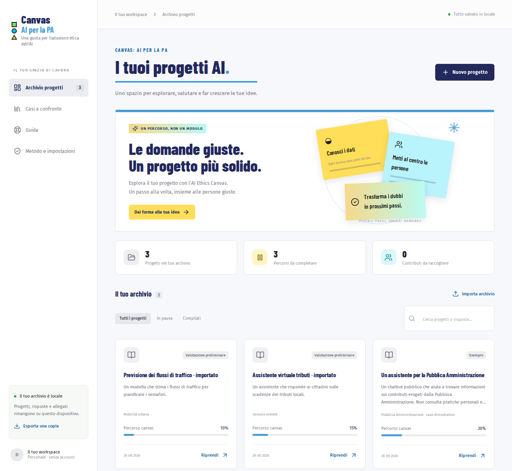
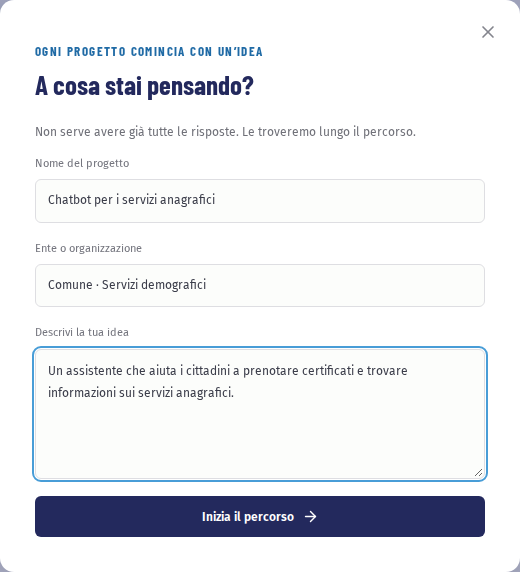

# Primi passi

In questo capitolo apri l’esempio, crei il tuo primo progetto e impari a ritrovarlo. Servono cinque minuti.

## L’archivio

All’apertura vedi l’«Archivio progetti»: è la pagina da cui parte tutto. Ci trovi i tuoi progetti, quanti sono da completare e una ricerca che guarda anche dentro le risposte.

Le schede «Tutti i progetti», «In pausa» e «Compilati» filtrano l’elenco. Ogni progetto mostra lo stato e la percentuale di compilazione; con «Riprendi» torni al punto in cui eri rimasto.

## Prova con l’esempio

Se è la prima volta, parti da un caso già avviato: un chatbot che aiuta i cittadini a trovare informazioni sui contributi pubblici.

1. Nell’archivio premi «Apri l’esempio».
2. Si apre il percorso alla quinta domanda: le prime quattro hanno già una risposta di esempio.
3. Scorri le domande, prova a scrivere, cambia stato a una risposta. Puoi eliminare l’esempio quando vuoi.

[Apri l’esempio](#app-demo)

> **Suggerimento.** Le risposte dell’esempio sono illustrative: non usarle per un progetto reale senza adattarle.

## Crea il tuo progetto

1. Premi «Nuovo progetto».
2. Scrivi il nome, l’ente o l’ufficio e una breve descrizione dell’idea: a chi servirà e che cosa dovrebbe fare. Non serve avere già tutte le risposte.
3. Premi «Inizia il percorso».

[Crea un nuovo progetto](#app-new)

## Il tuo lavoro resta qui

Ogni modifica viene salvata subito sul dispositivo: in alto a destra leggi «Tutto salvato in locale». Puoi chiudere e riprendere quando vuoi.

Salvare in locale però non è una copia di sicurezza. Se svuoti i dati del browser o cambi computer, i progetti non ti seguono. Per questo leggi [Salvare e spostare i dati](05-dati.md) prima di lavorare su un progetto reale.

Prosegui con [Compilare il percorso](02-compilare.md).
