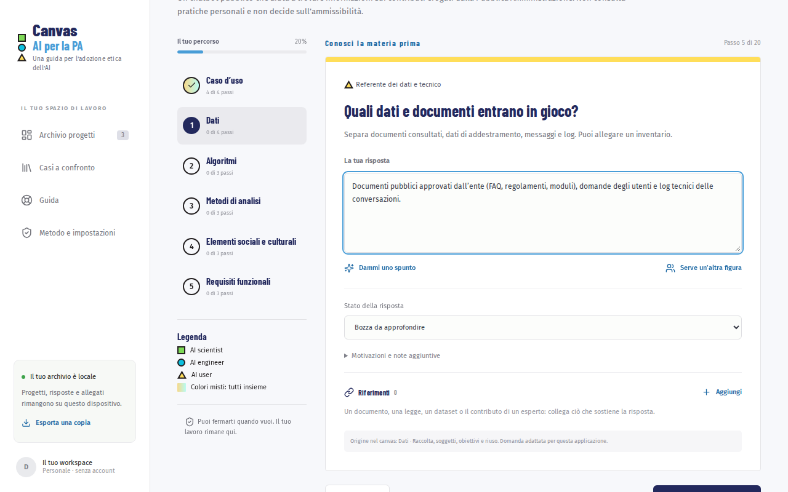
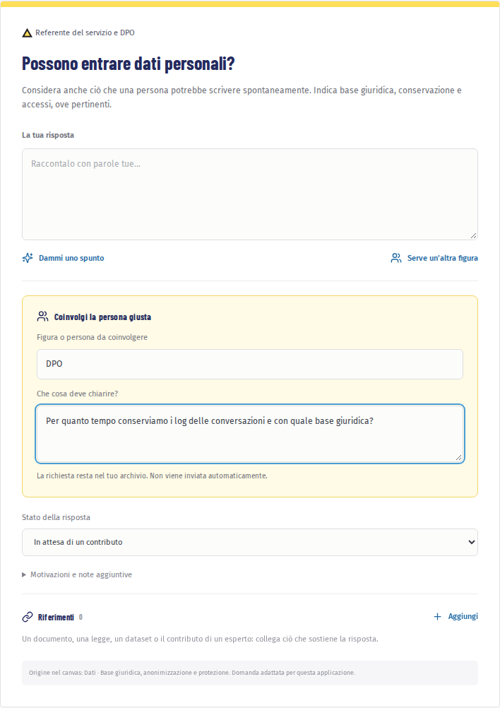

# Compilare il percorso

Il percorso è fatto di venti domande in sei sezioni: Caso d’uso, Dati, Algoritmi, Metodi di analisi, Elementi sociali e culturali, Requisiti funzionali. A sinistra vedi a che punto sei; ogni sezione indica quante risposte hai completato.

## Leggere una domanda

Ogni domanda ha tre elementi:

- **la domanda**, con una breve spiegazione del perché conta;
- **la figura indicata**, cioè chi di solito sa rispondere (ad esempio il referente del servizio o il DPO);
- **i colori e le forme** del profilo: verde con il quadrato per AI scientist, ciano con il cerchio per AI engineer, giallo con il triangolo per AI user. I colori sfumati indicano domande da affrontare insieme.

Nella colonna «Il tuo percorso» ogni sezione ha un bollo. Quando hai completato tutti i passi di una sezione, il bollo si colora e mostra il segno di spunta.

## Rispondere

1. Scrivi la risposta con parole tue nel campo sotto la domanda.
2. Se non sai da dove cominciare, premi «Dammi uno spunto»: compaiono esempi già pronti. Sceglierne uno lo inserisce come bozza, da adattare al tuo progetto.
3. Scegli lo stato della risposta in «Stato della risposta»:
   - «Bozza da approfondire»: hai scritto qualcosa ma va ancora verificato;
   - «Risposta confermata»: la risposta è completa;
   - «In attesa di un contributo»: serve qualcun altro;
   - «Non applicabile · motiva nella risposta»: la domanda non riguarda il progetto, e nella risposta spieghi perché.
4. Premi «Prossimo passo». Se la risposta era una bozza con del testo, il pulsante diventa «Conferma e continua» e la segna come confermata.

Con «Indietro» torni alla domanda precedente; con «Salva e riprendi più avanti» metti il progetto in pausa e torni all’archivio.

> **Attenzione.** Contano come completate solo le risposte confermate o non applicabili con una motivazione. Una bozza o una richiesta in attesa restano da completare, anche se hanno del testo.

## Coinvolgere un’altra figura

Spesso una risposta richiede chi conosce i dati, il contratto con il fornitore o la normativa.

1. Premi «Serve un’altra figura».
2. Nel riquadro «Coinvolgi la persona giusta» indica la figura e che cosa deve chiarire.
3. La risposta passa allo stato «In attesa di un contributo» e compare tra i contributi in attesa nel riepilogo.

La richiesta resta nel tuo archivio: non viene inviata a nessuno. Puoi copiarla in una mail o portarla in riunione.

## Note e motivazioni

In «Motivazioni e note aggiuntive» annoti dubbi, decisioni prese o il motivo di una scelta. Le note compaiono nei documenti esportati ma non contano per la completezza.

## Collegare le fonti

Una risposta è più solida se rimanda a un documento: un regolamento, un inventario dei dati, un contratto, un test.

1. Nella sezione «Riferimenti» della domanda premi «Aggiungi».
2. Scegli il tipo, scrivi un titolo e, se c’è, il collegamento. Puoi allegare un file locale fino a 10 MB.
3. Nell’«Estratto testuale (facoltativo)» incolla il passaggio che sostiene la risposta.
4. Premi «Aggiungi riferimento».

Per i file di testo (TXT, MD, CSV, JSON), Word (DOCX), OpenDocument (ODT) e PDF puoi ricavare l’estratto anche dopo, con «Estrai testo dal file (in locale)»: il testo viene letto sul dispositivo e non viene inviato a nessuno. Conserva poi solo il passaggio pertinente. Un PDF ottenuto da una scansione non contiene testo selezionabile e un file protetto da password non si può leggere: in questi casi, e per le immagini, incolla a mano il passaggio.

> **Perché l’estratto conta.** L’assistente può usare come fonte solo l’estratto: non apre i collegamenti e non legge gli allegati.

Prosegui con [Farsi aiutare dall’assistente](03-assistente.md), oppure salta a [Risultato ed esportazioni](04-risultato.md).
