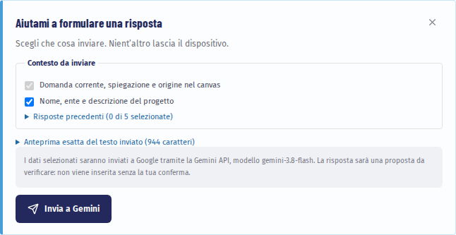

# Farsi aiutare dall’assistente

L’assistente usa Gemini, il modello di intelligenza artificiale di Google, per spiegare le domande e preparare bozze. È facoltativo: il percorso, le regole di completezza e i risultati funzionano allo stesso modo anche senza.

## Prima di cominciare

Ti serve una **chiave API Gemini**, creata in Google AI Studio. Un abbonamento all’app Gemini non basta. Se la chiave te la fornisce l’ente, chiedi a chi l’ha configurata; i dettagli sono nel capitolo [Installare e configurare](08-installare.md).

## Attivare l’assistente

1. Apri «Metodo e impostazioni» e scorri fino a «Assistente Gemini (facoltativo)».
2. Spunta «Attiva l’assistente durante la compilazione» e scegli il modello. Quello consigliato va bene nella maggior parte dei casi.
3. Incolla la chiave in «Chiave API Gemini» e premi «Usa per questa sessione» (versione web) o «Salva nel portachiavi» (versione desktop).
4. Premi «Verifica connessione».

[Vai alle impostazioni](#app-settings)

Nella versione web la chiave resta solo nella scheda aperta e si perde ricaricando la pagina. Nella versione desktop è conservata nel portachiavi del sistema operativo. Con «Elimina chiave e configurazione» cancelli chiave e preferenze.

## Le tre azioni

Con l’assistente attivo, sotto ogni domanda compaiono tre pulsanti:

- «Spiegami la domanda»: che cosa chiede, perché conta per il tuo progetto, quali informazioni servono;
- «Aiutami a formulare una risposta»: una bozza basata solo su ciò che invii;
- «Che cosa manca per rispondere?»: le informazioni mancanti e chi può fornirle.

## Scegliere che cosa inviare

Prima di ogni richiesta decidi tu che cosa parte. La domanda corrente è sempre inclusa; il resto lo spunti uno per uno: la descrizione del progetto, la risposta già scritta, le risposte precedenti, gli estratti dei riferimenti.

Apri «Anteprima esatta del testo inviato» per leggere parola per parola che cosa riceverà Google. Poi premi «Invia a Gemini». Se ci ripensi, «Annulla richiesta» la interrompe.

> **Attenzione.** Non inviare dati personali, dati riservati o documenti interni dell’ente. Gli allegati non vengono mai inviati come file e i collegamenti non vengono aperti.

## Usare la proposta

La risposta di Gemini è una proposta da verificare. Ogni affermazione è etichettata:

- **dichiarato**: viene da ciò che hai scritto tu;
- **documentato**: viene dall’estratto di un riferimento;
- **ipotesi da confermare**: non ha una fonte tra quelle inviate.

Se una citazione non corrisponde a ciò che hai inviato, l’app la segnala con «citazione non corrispondente al contesto inviato».

Puoi modificare il testo nella «Proposta modificabile» e poi:

- «Inserisci come bozza», se la risposta è vuota;
- «Aggiungi in coda come bozza», per tenere ciò che hai già scritto;
- «Sostituisci la risposta…», che chiede una conferma esplicita.

In ogni caso la risposta torna allo stato di bozza e conserva l’indicazione del modello e della data. Spetta a te confermarla.

> **Sull’AI Act.** Per la domanda sull’inquadramento normativo l’assistente organizza le informazioni e i punti da verificare, ma non indica categorie di rischio né conformità: quella valutazione va fatta con un esperto legale.

Prosegui con [Risultato ed esportazioni](04-risultato.md).
