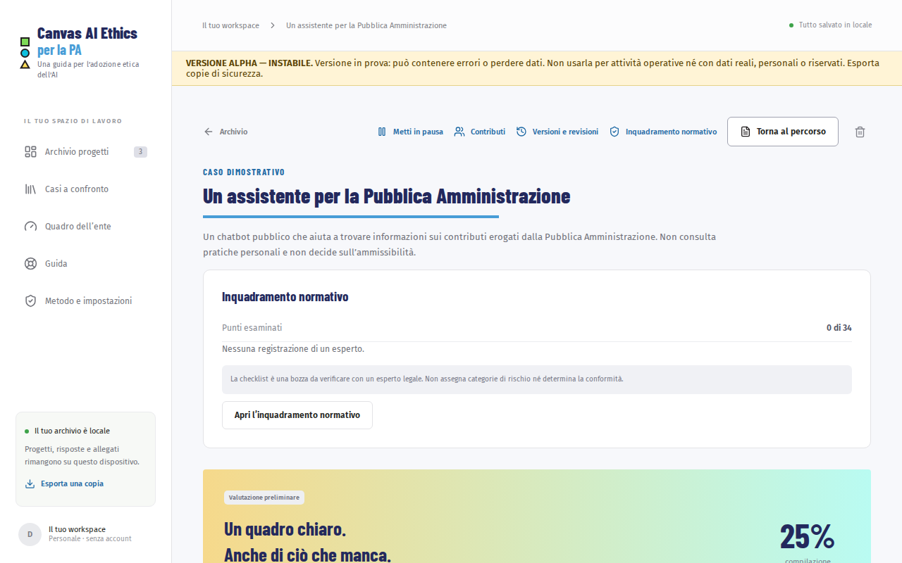
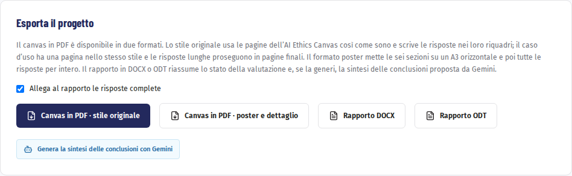

# Risultato ed esportazioni

Il riepilogo mostra a che punto è la valutazione e che cosa manca. Da lì esporti il canvas in PDF e il rapporto da condividere.

## Il riepilogo

Dentro un progetto premi «Vedi il risultato» (o «Guarda il risultato» all’ultima domanda). Trovi:

- lo **stato**: bozza, valutazione preliminare o compilazione completa, con la percentuale;
- il **profilo dichiarato**: tipo di soluzione, chi la usa e quanto può fare da sola;
- **la base della valutazione**: riferimenti raccolti, contributi in attesa, risposte senza riferimenti;
- l’elenco di **ciò che manca**, con i punti essenziali in evidenza. Ogni voce porta direttamente alla domanda.

Con «Torna al percorso» riprendi la compilazione.

> **Completezza non è validazione.** Una valutazione completa dice che tutte le domande hanno una risposta, non che le risposte siano state verificate. Prima di decidere, fai rivedere evidenze, misure e responsabilità alle figure competenti.

## Esportare il canvas in PDF

Nel riquadro «Esporta il progetto» scegli uno dei due formati:

- «Canvas in PDF · stile originale»: il canvas originale, con copertina, istruzioni, glossario e le cinque pagine di sezione, e le tue risposte scritte nei riquadri a cui si riferiscono. Il caso d’uso, che nell’originale ha solo il riquadro in copertina, ha una pagina nello stesso stile. Le risposte che non entrano nei riquadri, e quelle che nel canvas non hanno un riquadro («Chi rischia di rimanere fuori?» e «Quando sarà necessario tornare su questa valutazione?»), proseguono nelle pagine «Risposte complete»; un’ultima pagina raccoglie note, contributi e riferimenti;
- «Canvas in PDF · poster e dettaglio»: un poster A3 con le sei sezioni, da appendere o proiettare, seguito da tutte le risposte per intero.

Il PDF viene generato sul dispositivo: nessun dato viene inviato.

## Esportare il rapporto

«Rapporto DOCX» e «Rapporto ODT» producono lo stesso documento, da aprire con Word o LibreOffice. Contiene:

- descrizione del progetto e stato della compilazione;
- punti essenziali ancora da completare e contributi in attesa;
- una nota fissa sull’inquadramento normativo;
- in allegato, se lasci spuntato «Allega al rapporto le risposte complete», tutte le risposte.

C’è anche «Esporta rapporto Markdown», un file di testo semplice utile per archiviare o confrontare versioni.

## La sintesi delle conclusioni con Gemini

Se l’assistente è attivo, puoi aggiungere al rapporto una sintesi delle conclusioni.

1. Premi «Genera la sintesi delle conclusioni con Gemini».
2. Scegli se aggiungere le note e gli estratti dei riferimenti. Controlla l’anteprima: i nomi delle persone indicate non vengono mai inviati.
3. Premi «Genera la sintesi».
4. Rileggi e modifica ogni parte: sintesi, punti di forza, rischi, azioni con il responsabile, informazioni mancanti, conclusioni per sezione. Ogni voce riporta le sue fonti; quelle non riconosciute sono segnate «da verificare».
5. Esporta il rapporto: i pulsanti diventano «Rapporto DOCX con sintesi» e «Rapporto ODT con sintesi».

Se Gemini scrive frasi che somigliano a una classificazione AI Act o a una dichiarazione di conformità, l’app le toglie e ti mostra quali.

La sintesi non viene salvata nel progetto: se cambi pagina prima di esportare, va rigenerata. Con «Rigenera» ne chiedi un’altra, con «Scarta la sintesi» torni al rapporto senza.

Prosegui con [Salvare e spostare i dati](05-dati.md).
