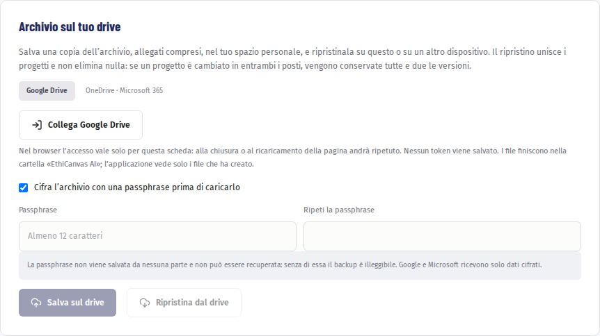

# Salvare e spostare i dati

L’app salva tutto sul dispositivo, ma una copia di sicurezza la fai tu: con un file da conservare oppure sul tuo drive personale.

## Una copia in un file

1. Premi «Esporta una copia» nella barra laterale, oppure «Esporta archivio» in «Metodo e impostazioni».
2. Ottieni un file JSON con tutti i progetti, le risposte e gli allegati.
3. Conservalo dove l’ente conserva i documenti di lavoro.

Per riportare i progetti, nell’archivio premi «Importa archivio» e scegli il file. L’importazione crea copie con il nome «· importato» e non sovrascrive i progetti già presenti.

> **Nel browser.** I dati del browser possono essere cancellati dalla pulizia della cronologia o dalle regole del sistema. In «Metodo e impostazioni» puoi premere «Richiedi persistenza browser» per chiedere al browser di non eliminarli, ma la copia in un file resta la protezione migliore.

## Sul tuo drive

In «Metodo e impostazioni», nel riquadro «Archivio sul tuo drive», puoi salvare l’archivio su Google Drive o su OneDrive di Microsoft 365 e ripristinarlo su questo o su un altro computer.

1. Scegli il servizio e premi il pulsante **Collega**. Si apre la pagina di accesso di Google o Microsoft: entra con il tuo account e concedi il permesso.
2. Lascia spuntato «Cifra l’archivio con una passphrase prima di caricarlo» e scrivi una passphrase di almeno 12 caratteri, poi ripetila in «Ripeti la passphrase».
3. Premi «Salva sul drive». Il file finisce nella cartella «EthiCanvas AI» del tuo drive.

[Vai alle impostazioni](#app-settings)

> **Non perdere la passphrase.** Non viene salvata da nessuna parte e non si può recuperare: senza di essa il backup è illeggibile. Con la cifratura, Google e Microsoft ricevono solo dati cifrati.

Se il servizio appare come non configurato, chi ha installato l’app non lo ha ancora registrato: vedi [Installare e configurare](08-installare.md).

## Ripristinare

1. Sull’altro dispositivo collega lo stesso account.
2. Premi «Ripristina dal drive». Se l’archivio è cifrato, inserisci la passphrase e premi «Decifra e ripristina».

Il ripristino unisce i progetti e non cancella nulla:

- i progetti nuovi vengono aggiunti;
- quelli cambiati solo sul drive vengono aggiornati;
- se un progetto è cambiato in entrambi i posti, vengono conservate tutte e due le versioni: la più recente con il nome originale, l’altra con l’aggiunta «copia locale in conflitto» o «copia dal drive in conflitto». Confrontale e tieni quella giusta.

Prima di sovrascrivere un archivio salvato da un altro dispositivo, l’app ti chiede conferma e ti suggerisce di ripristinarlo prima.

## Accesso e disconnessione

Nel browser l’accesso vale solo per la scheda aperta: ricaricando la pagina va ripetuto. Nell’app desktop resta nel portachiavi del sistema. Con «Scollega» lo elimini.

Hai finito la parte per chi compila. Se coordini il lavoro di un gruppo, prosegui con [Versioni, revisioni e riesame](06-versioni.md).
