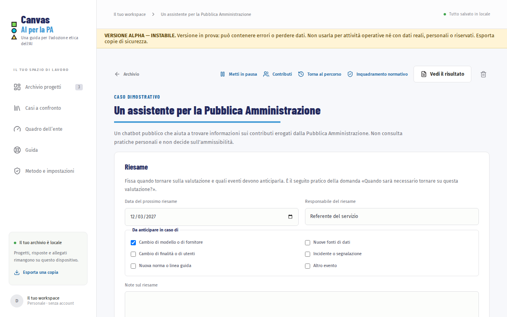
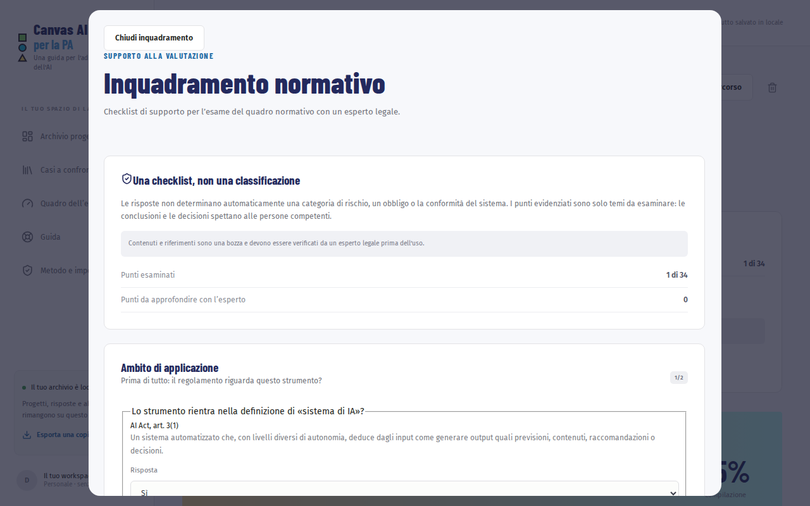

# Versioni, revisioni e riesame

Una valutazione cambia insieme al progetto. In questo capitolo impari a conservarne le tappe, a registrare chi l’ha rivista e a fissare quando tornarci.

Dentro un progetto premi «Versioni e revisioni». Con «Torna al percorso» riprendi la compilazione.

## Salvare una versione

Una versione è una fotografia della valutazione: risposte, stati, note e riferimenti in quel momento. Non cambia più, anche se poi modifichi le risposte.

1. Premi «Salva una versione».
2. Scrivi il «Nome della versione», ad esempio *Dopo il primo incontro* o *Prima del rilascio*.
3. Scegli il motivo e, se serve, aggiungi una nota.
4. Premi «Salva la versione».

Salva una versione alle tappe importanti: la fine di un incontro, l’invio a chi deve rivedere, un cambio di fornitore o di dati.

> **Gli allegati non vengono duplicati.** Una versione conserva titolo, collegamento ed estratto di ogni riferimento, ma non il file allegato: l’archivio resta leggero.

L’app salva da sola una versione prima delle operazioni che cambiano molte risposte insieme: il ripristino di una versione e la precompilazione dai casi a confronto.

## Registrare una revisione

Una revisione dice chi ha letto la valutazione e con quale esito. Non è una certificazione e non cambia la percentuale di completezza né lo stato delle risposte.

1. Premi «Registra una revisione».
2. Scrivi il «Ruolo di chi rivede», ad esempio DPO, responsabile del servizio o esperto legale. Il nome è facoltativo: se lo scrivi, comparirà nei backup e nei documenti esportati.
3. Scegli l’esito:
   - «Valutazione condivisa»: chi rivede è d’accordo con quanto registrato;
   - «Condivisa con condizioni»: è d’accordo a patto che accada qualcosa, da scrivere in «Condizioni»;
   - «Da rivedere»: la valutazione va ripresa.
4. Aggiungi le osservazioni e premi «Registra la revisione».

Ogni revisione salva anche una versione dello stato attuale, così resta chiaro che cosa è stato rivisto. Se dopo la revisione modifichi una risposta, sotto la domanda compare «Modificata dopo l’ultima revisione».

Il riepilogo del progetto mostra l’ultima revisione e il prossimo riesame; il rapporto e il PDF in formato poster riportano anche lo storico completo.

## Esaminare l’inquadramento normativo

Dentro il progetto premi «Inquadramento normativo». La checklist raccoglie temi da esaminare con un esperto legale: non assegna categorie di rischio e non determina obblighi o conformità.

1. Per ogni punto seleziona «Sì», «No», «Da verificare» o «Non pertinente» e annota i dubbi per l’esperto. Puoi scrivere una nota anche prima di scegliere: il punto resta «Da esaminare» e non viene contato. Per annullare una risposta torna a «Da esaminare».
2. Scrivi le conclusioni e le fonti che le sostengono.
3. Indica il «Ruolo dell’esperto legale» e premi «Registra l’inquadramento». Il nome è facoltativo. La registrazione salva una versione e indica chi ha scritto le conclusioni e quando.
4. Se in seguito modifichi la checklist o le conclusioni, l’app segnala che l’inquadramento va riesaminato.

La checklist è una bozza: i contenuti e i riferimenti devono essere verificati da un esperto legale prima dell’uso. «Punti da approfondire» segnala temi per la revisione, non risultati automatici. Puoi riportare le conclusioni nella risposta del canvas solo come bozza: scegli se inserirle, aggiungerle al testo esistente o sostituirlo.

Se una nuova versione della checklist toglie un punto a cui avevi già risposto, la risposta non va persa: compare in «Voci non più presenti nella checklist» e nel rapporto, ma non viene più contata. Ripristinando una versione salvata prima di compilare la checklist, il progetto torna senza inquadramento; quello attuale resta nella versione salvata in automatico prima del ripristino.

## Confrontare due versioni

1. Nella «Cronologia» premi «Confronta» accanto a una versione: viene confrontata con lo stato attuale.
2. Nel riquadro «Confronto» puoi scegliere qualunque coppia di versioni.
3. Per ogni domanda cambiata vedi le parole aggiunte, in verde, e quelle tolte, in rosso, insieme ai cambi di stato e ai riferimenti aggiunti o tolti.
4. Se è cambiato l’inquadramento normativo, la parte «Inquadramento normativo» elenca i punti della checklist con la risposta prima e dopo, le note modificate, le conclusioni, le fonti e la registrazione dell’esperto.

Con «Mostra anche le domande invariate» vedi tutto il questionario.

## Tornare a una versione precedente

Premi «Ripristina» accanto alla versione e conferma. Prima del ripristino l’app salva lo stato attuale come una nuova versione: se cambi idea, puoi ripristinare quella.

Un riferimento ritorna con il suo allegato solo se il file è ancora nel progetto; altrimenti ritornano titolo, collegamento ed estratto.

## Pianificare il riesame

Nel riquadro «Riesame»:

1. scegli la «Data del prossimo riesame» e il «Responsabile del riesame»;
2. spunta gli eventi che devono anticiparlo, come un «Cambio di modello o di fornitore» o «Nuove fonti di dati»;
3. premi «Aggiungi al calendario» per scaricare un file da aprire con il tuo calendario (Outlook, Google Calendar, Thunderbird).

Nell’archivio la scheda del progetto indica quando manca poco al riesame o se è scaduto.

Prosegui con [Coordinare una valutazione](07-coordinare.md).
