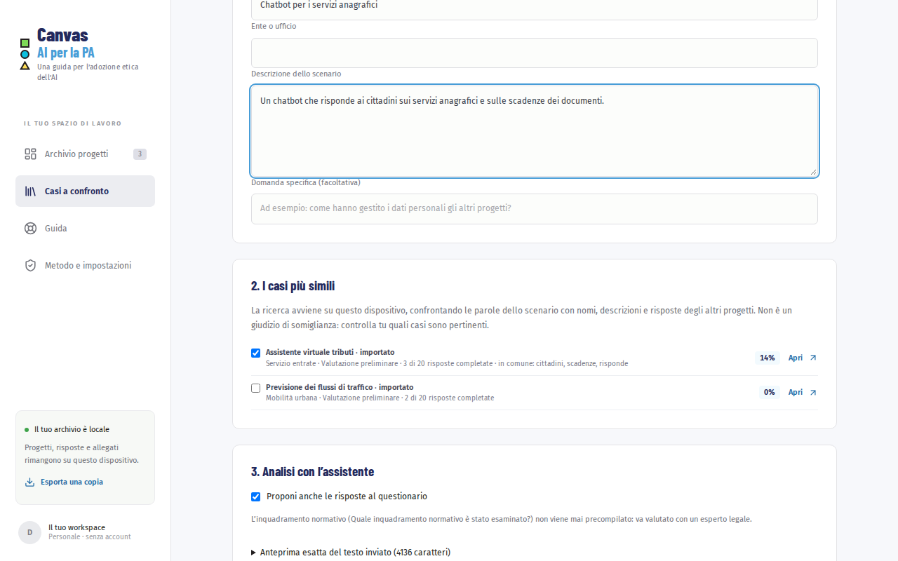

# Coordinare una valutazione

Questo capitolo è per chi organizza il lavoro: il referente del progetto o la figura che modera il gruppo.

## Quando compilare il canvas

Il canvas va compilato per ogni strumento di AI all’inizio della fase di sviluppo, quando le scelte si possono ancora cambiare. Va poi ripreso a ogni cambiamento importante: un nuovo modello, nuove fonti di dati, un uso diverso. La domanda «Quando sarà necessario tornare su questa valutazione?» serve a fissare questi momenti, e la pagina [Versioni, revisioni e riesame](06-versioni.md#pianificare-il-riesame) a non dimenticarli.

## Organizzare il gruppo con i profili

Ogni domanda indica il profilo che di solito sa rispondere:

- **AI scientist** (verde, quadrato): ricerca e sviluppa i sistemi, anche fuori dall’ente;
- **AI engineer** (ciano, cerchio): allena, implementa e mantiene i sistemi;
- **AI user** (giallo, triangolo): usa i sistemi nel proprio lavoro, come un funzionario o un assessore.

Le domande con colori sfumati vanno affrontate insieme. Le forme servono a chi non distingue bene i colori.

Un modo di lavorare che funziona:

1. Individua una figura moderatrice che guida la sessione.
2. Crea il progetto prima dell’incontro, con nome, ente e descrizione.
3. In riunione procedete sezione per sezione. Le domande a cui nessuno sa rispondere diventano richieste con «Serve un’altra figura»: invitate al tavolo chi serve, come il DPO, il fornitore o l’esperto legale.
4. Dopo l’incontro, ognuno completa le risposte del proprio profilo. Con un solo dispositivo, le richieste di contributo indicano chi deve rispondere; con più dispositivi, usate l’archivio sul drive o la copia in un file per passarvi il progetto.
5. Chiudete con il riepilogo: che cosa manca, chi se ne occupa, entro quando.

> **Un dispositivo, un archivio.** L’app non ha un archivio condiviso in tempo reale. Se più persone modificano lo stesso progetto su computer diversi, al ripristino dal drive le versioni in conflitto vengono conservate entrambe: decidete chi tiene la versione di riferimento.

## Partire dai casi già valutati

L’archivio dell’ente è anche una base di conoscenza. In «Casi a confronto» descrivi un nuovo scenario, oppure scegli un progetto già avviato, e l’app cerca i progetti più simili tra quelli con risposte.

1. Scegli «Descrivi un nuovo scenario» oppure «Parti da un progetto dell’archivio».
2. Leggi i casi più simili. La ricerca avviene sul dispositivo e indica le parole in comune; controlla tu quali casi sono davvero pertinenti e spunta quelli da usare.
3. Con l’assistente attivo puoi aggiungere una «Domanda specifica (facoltativa)», ad esempio come altri progetti hanno gestito i dati personali.
4. Premi «Analizza con Gemini». Ricevi somiglianze, differenze, soluzioni da valutare e raccomandazioni, con le fonti.
5. Se hai lasciato spuntato «Proponi anche le risposte al questionario», ricevi anche bozze di risposta. Modificale e premi «Crea il progetto con le risposte selezionate» oppure «Inserisci nelle risposte vuote». Le risposte già scritte non vengono mai toccate.

[Apri i casi a confronto](#app-knowledge)

Per costruire una base di conoscenza comune, raccogliete le copie degli archivi dei vari uffici e importatele in un unico dispositivo con «Importa archivio». Gli esempi dimostrativi non vengono usati.

> **Riservatezza.** Analizzando i casi, nomi, enti, descrizioni e risposte dei progetti selezionati partono verso Google. Allegati, note e persone indicate no. Seleziona solo i progetti che puoi condividere.

## Rivedere i risultati

Il riepilogo e il rapporto aiutano a chiudere la valutazione, ma non la sostituiscono:

- controllate che le risposte confermate abbiano una fonte: il riepilogo conta quelle senza riferimenti;
- trattate le parti proposte dall’assistente come bozze, anche dopo la conferma: nei documenti sono segnalate;
- per l’inquadramento normativo affidatevi a un esperto legale. L’app non classifica i sistemi secondo l’AI Act;
- registrate ogni revisione nell’app, con il ruolo di chi rivede e l’esito, e fissate la data del riesame: vedi [Versioni, revisioni e riesame](06-versioni.md);
- conservate il rapporto esportato insieme alla documentazione del progetto, con la data.

Per gli aspetti tecnici prosegui con [Installare e configurare](08-installare.md).
