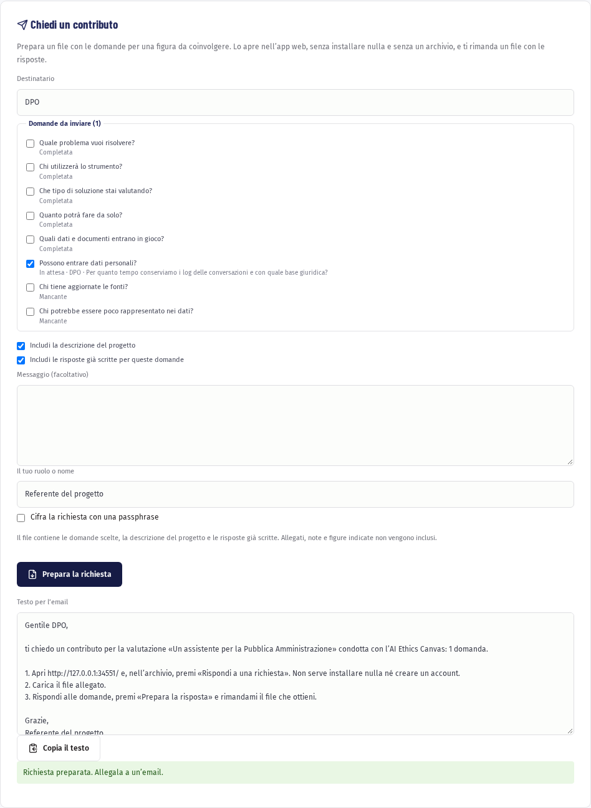
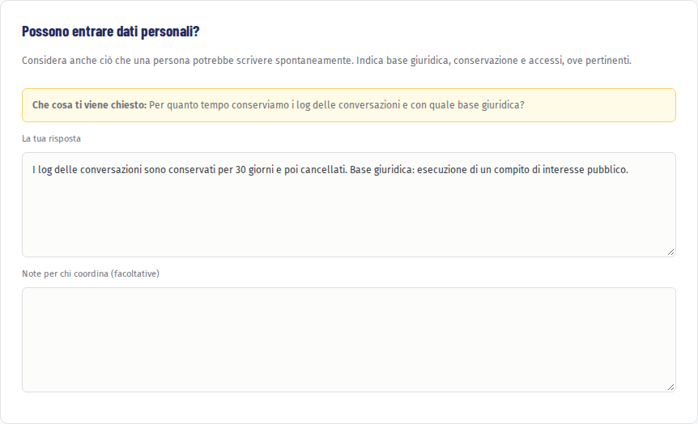

# Contributi delle figure coinvolte

Alcune risposte richiedono chi conosce i dati, il contratto con il fornitore o la normativa. Con i contributi chiedi a queste persone di rispondere solo alle domande che le riguardano. Si scambiano due file per email: non serve un server, non serve un account e chi risponde non deve installare nulla.

## Chiedere un contributo

Dentro un progetto premi «Contributi».

1. In «Destinatario» scegli o scrivi la figura da coinvolgere. Le domande in attesa per quella figura, segnate nel percorso con «Serve un’altra figura», vengono selezionate da sole; puoi aggiungerne o toglierne.
2. Decidi se inviare anche la descrizione del progetto e le risposte già scritte. Note, allegati e figure indicate non vengono mai inclusi.
3. Aggiungi un messaggio, se serve, e il tuo ruolo.
4. Lascia spuntato «Cifra la richiesta con una passphrase» e scegli una passphrase di almeno 12 caratteri.
5. Premi «Prepara la richiesta». Scarichi un file da allegare all’email.
6. Sotto compare un testo pronto: premi «Copia il testo» e incollalo nell’email. Spiega a chi riceve che cosa fare.

> **Passphrase su un altro canale.** Comunica la passphrase per telefono o di persona, non nella stessa email del file.

## Rispondere a una richiesta

Questa parte è per chi riceve la richiesta.

1. Apri l’app all’indirizzo indicato nell’email e premi «Rispondi a una richiesta». Non serve un account.
2. In «Carica il file di richiesta» scegli il file ricevuto. Se è cifrato, inserisci la passphrase e premi «Apri la richiesta».
3. Per ogni domanda leggi la spiegazione, «Che cosa ti viene chiesto» e, se presente, la risposta già scritta.
4. Scrivi la tua risposta. Nelle «Note per chi coordina (facoltative)» puoi aggiungere dubbi o verifiche da fare.
5. Indica il tuo ruolo; il nome è facoltativo.
6. Premi «Prepara la risposta» e rimanda il file a chi ti ha scritto. Se la richiesta era cifrata, la risposta usa la stessa passphrase.

[Rispondi a una richiesta](#app-respond)

Le tue risposte non vengono salvate sul dispositivo: prepara il file prima di chiudere la pagina. Se provi a chiuderla prima, il browser ti avvisa.

## Importare la risposta

1. Nel progetto premi «Contributi» e, in «File di risposta», scegli il file ricevuto. Se è cifrato, inserisci la passphrase e premi «Decifra».
2. Per ogni domanda vedi la proposta, l’eventuale nota e la risposta attuale. Spunta «Usa questa proposta» per quelle da tenere.
3. Se la domanda ha già una risposta, scegli se aggiungere la proposta in coda o sostituire la risposta attuale.
4. Premi «Inserisci i contributi selezionati».

Prima di inserire i contributi l’app salva una versione del progetto, così puoi confrontare o tornare indietro da «Versioni e revisioni». Le risposte inserite tornano in bozza e nelle note resta chi ha dato il contributo e quando: rileggile e confermale nel percorso.

Una risposta preparata per un altro progetto viene rifiutata.

Per gli aspetti tecnici prosegui con [Installare e configurare](09-installare.md).
